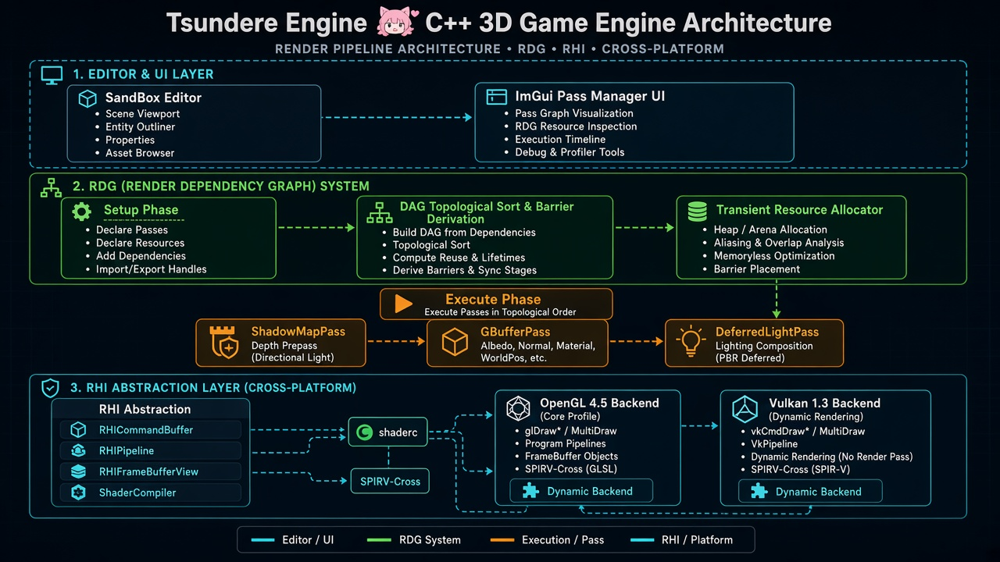
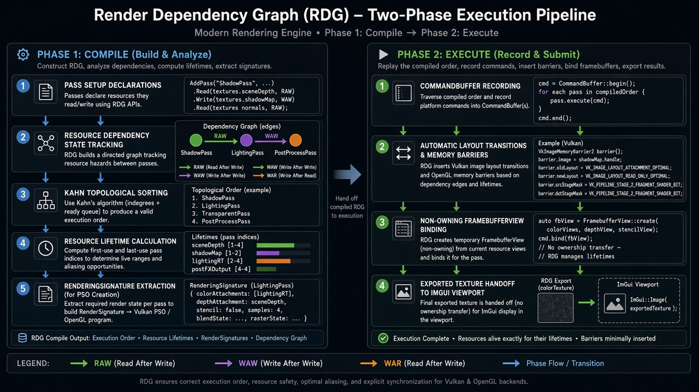
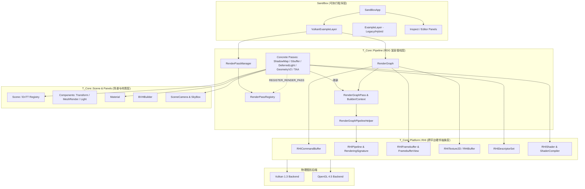
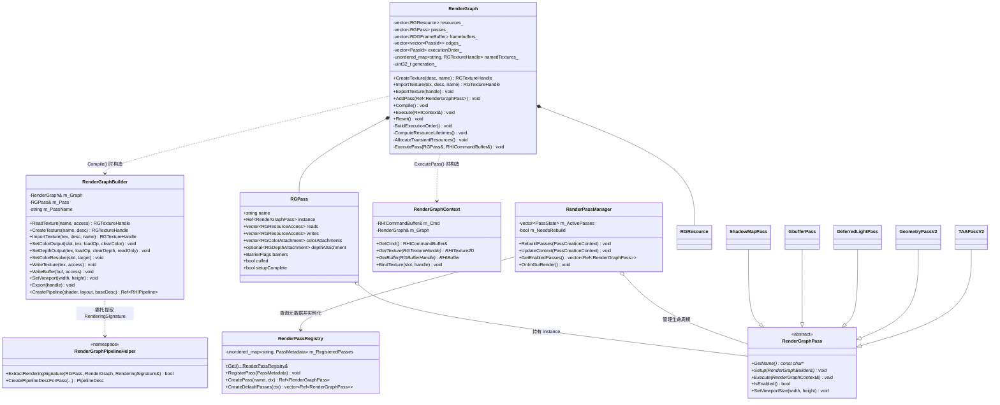

# Tsundere 引擎 RDG (Render Dependency Graph) 与整体架构全览

> **文档定位**：本文档对 Tsundere 引擎当前的整体架构、RDG（渲染依赖图）系统的核心设计、模块与类之间的依赖关系、跨 API（OpenGL 4.5 / Vulkan 1.3）RHI 协同机制，以及当前代码库的审查结论与演进建议进行全面梳理。

---

## 目录

1. [架构总览图](#1-架构总览图)
2. [宏观分层架构：为什么这样设计？](#2-宏观分层架构为什么这样设计)
3. [核心系统深度剖析：RDG (Render Dependency Graph)](#3-核心系统深度剖析rdg-render-dependency-graph)
   - [3.1 为什么从传统 RenderPass 演进到 RDG V2？](#31-为什么从传统-renderpass-演进到-rdg-v2)
   - [3.2 RDG 核心数据结构与安全句柄设计](#32-rdg-核心数据结构与安全句柄设计)
   - [3.3 两阶段生命周期：Compile 与 Execute](#33-两阶段生命周期compile-与-execute)
   - [3.4 自动注册与运行时管理系统](#34-自动注册与运行时管理系统)
4. [模块与类依赖关系图谱](#4-模块与类依赖关系图谱)
   - [4.1 模块级依赖图](#41-模块级依赖图)
   - [4.2 RDG 与 Pass 类关系图 (UML)](#42-rdg-与-pass-类关系图-uml)
   - [4.3 RDG 与 RHI 后端协同关系图](#43-rdg-与-rhi-后端协同关系图)
5. [关键设计精髓解读（“为什么要这样写”）](#5-关键设计精髓解读为什么要这样写)
6. [现有 Pass 管线数据流梳理](#6-现有-pass-管线数据流梳理)
7. [代码审查报告：当前完成度与潜在问题点](#7-代码审查报告当前完成度与潜在问题点)

---

## 1. 架构总览图





---

## 2. 宏观分层架构：为什么这样设计？

Tsundere 引擎目前采用了清晰的 **四层解耦架构**，从上至下依次为：

```
┌────────────────────────────────────────────────────────────────────────────┐
│ Layer 1: 应用与编辑器层 (SandBox)                                          │
│  ├─ VulkanExampleLayer / ExampleLayer (视口管理、相机交互、驱动 RDG)       │
│  ├─ Inspect / ModelEditorPanel / ModelImportPanel (ECS 实体与材质编辑)     │
│  └─ RenderPassManager UI (运行时动态开关 Pass、触发 RDG 重建)              │
├────────────────────────────────────────────────────────────────────────────┤
│ Layer 2: 场景与管线编排层 (T_Core::Scene & T_Core::Pipeline)               │
│  ├─ ECS 场景图 (EnTT Registry: Transform, MeshRender, Light, Camera)       │
│  ├─ RenderPassRegistry (静态宏自注册工厂) + RenderPassManager              │
│  ├─ RenderGraph (DAG 依赖图、Kahn 拓扑排序、屏障推导、瞬态资源分配)        │
│  └─ RenderGraphPass 子类群 (ShadowMapPass, GbufferPass, DeferredLightPass, │
│     GeometryPassV2, TAAPassV2...)                                          │
├────────────────────────────────────────────────────────────────────────────┤
│ Layer 3: 跨平台硬件抽象层 (T_Core::Platform::RHI)                          │
│  ├─ RHICommandBuffer / RHIPipeline (含 RenderingSignature)                 │
│  ├─ RHITexture2D / RHIBuffer / RHIFramebuffer / RHIFramebufferView         │
│  ├─ RHIDescriptorSet (统一 UBO/SSBO/Sampler 绑定 + Dynamic Offset)         │
│  └─ ShaderCompiler (shaderc -> SPIR-V -> SPIRV-Cross 反射与 GLSL 430 转译) │
├────────────────────────────────────────────────────────────────────────────┤
│ Layer 4: 图形 API 物理后端 (OpenGL 4.5 & Vulkan 1.3)                       │
│  ├─ OpenGL Backend: GLCommandBuffer, GLFramebufferView, GLPipeline (VAO)   │
│  └─ Vulkan Backend: VulkanCommandBuffer (vkCmdBeginRendering 动态渲染),    │
│     VulkanPipeline, VulkanDescriptorSet, VulkanTexture2D (自动 Layout 转换)│
└────────────────────────────────────────────────────────────────────────────┘
```

### 为什么要这样分层？

1. **彻底隔离上层算法与底层图形 API 差异**：
   - 在写 `GbufferPass` 或 `DeferredLightPass` 时，Pass 开发者完全不需要关心底层是 OpenGL 还是 Vulkan（除极个别过渡期宏外），只需要操作 `RenderGraphBuilder`（声明读写）和 `RHICommandBuffer`（录制绘制指令）。
2. **用声明式资源图（RDG）取代人脑维护状态机**：
   - 传统管线（如早期 `ExampleLayer::OnUpdate` 中的手写分支）需要手动创建 FBO、手动 `Bind()/Unbind()`、手动传递裸 GL 纹理 ID（`renderResources.SceneColorTexture`）、手动插 `glMemoryBarrier`。一旦开启/关闭某个 Pass（如关掉 Shadow 或切换 Forward/Deferred），极易出现绑定错乱或漏加屏障。
   - 引入 RDG 后，每个 Pass 只声明**“我读什么、我写什么”**，图的拓扑排序、FBO 组装、内存屏障、图像布局转换全部由 `RenderGraph` 自动完成。

---

## 3. 核心系统深度剖析：RDG (Render Dependency Graph)

### 3.1 为什么从传统 RenderPass 演进到 RDG V2？

在代码库中可以清晰看到三代管线接口的演进轨迹：

| 阶段 | 代表类 / 接口 | 资源传递方式 | 痛点与局限 |
| :--- | :--- | :--- | :--- |
| **第一代：Legacy `RenderPass`** | `RenderPass::Execute(scene, RenderResources&)` | 全局 `RenderResources` 结构体存裸 `uint32_t` 纹理 ID；Pass 各自持有私有 `RHIFramebuffer` | 顺序硬编码在 `ExampleLayer`；FBO 与纹理强耦合，大量冗余拷贝；无法自动推导屏障；不支持 Vulkan 图像布局追踪 |
| **第二代：Lambda RDG (V1)** | `RenderGraph::AddPass(name, setupLambda, execLambda)` | 显式传递 `RGTextureHandle` 参数（如 `taaPass->AddToGraph(graph, sceneColor, velocity, depth)`） | 虽然有了 DAG 和自动 FBO，但主调方（`BuildRenderGraph`）仍需手动按顺序串联每个 Pass 的 `RGTextureHandle` 返回值，新增 Pass 必须修改主循环代码 |
| **第三代：Unified `RenderGraphPass` (V2)** | 继承 `RenderGraphPass`，重写 `Setup(builder)` & `Execute(ctx)` + `REGISTER_RENDER_PASS` | **符号化命名黑板**（如创建 `"SceneColor"` 自动注册为 `"Gbuffer.SceneColor"`，下游直接 `ReadTexture("Gbuffer.SceneColor")`） | **完全解耦**！添加顺序无关，支持静态自注册与 UI 动态开关，编译期自动连接资源边与推导 PSO 渲染签名 |

---

### 3.2 RDG 核心数据结构与安全句柄设计

核心文件：`T_Core/src/Pipeline/RenderGraph.h`、`T_Core/src/Pipeline/RenderGraphPass.h`

#### 1. 带代数的句柄 (`RGTextureHandle` / `RGBufferHandle`)
```cpp
struct RGTextureHandle {
    ResourceId id = InvalidResourceId;
    uint32_t generation = 0;
};
```
- **为什么要加 `generation`？**
  当视口缩放（Resize）或用户在 UI 中开关了某个 Pass 时，`RenderGraph::Reset()` 会被调用并递增 `generation_`。如果外部代码（如 Layer 或某个 Pass 成员变量）不小心缓存了旧图的 Handle，在下一次解析时会因为 `handle.generation != generation_` 立即报错拦截，而不会静默越界或读到错误的复用槽位。

#### 2. 窄视图隔离 (`RenderGraphBuilder` vs `RenderGraphContext`)
- **Setup 阶段**只暴露 `RenderGraphBuilder`：只允许声明资源读写、创建瞬态资源、设置 Attachment 和提取 `RenderingSignature`，**拿不到物理 `RHITexture2D*`**（因为此时物理纹理还没分配！）。
- **Execute 阶段**只暴露 `RenderGraphContext`（直接包装 `RenderGraph&` 与 `RHICommandBuffer&`）：只允许把已声明的 Handle 解析为物理 `RHITexture2D*`/`RHIBuffer*` 并录制 GPU 命令，**禁止在执行期动态改图或新建资源**。
- **为什么这样设计？** 这种编译期类型隔离从语法层面杜绝了“在 Setup 里发 DrawCall”或“在 Execute 里改依赖图”的架构违规。

---

### 3.3 两阶段生命周期：Compile 与 Execute

```
=====================================================================================
                        PHASE 1: RenderGraph::Compile()
        (仅在初始化、视口 Resize、或 Pass 启用状态变更时执行，非每帧重跑！)
=====================================================================================
  [1. Pass Setup 调用]
   遍历 passInstances_ -> 跳过禁用 Pass (culled = true)
   -> 调用 pass->Setup(builder) 收集 reads / writes / colorAttachments / depthAttachment
          │
          ▼
  [2. 依赖边与屏障推导 (Dependency & Barrier Analysis)]
   维护每个资源的 ResourceDependencyState (lastWriter, lastWriterAccess, readers):
   ├─ RAW (写后读): AddEdge(lastWriter -> curPass) + DeriveBarrier(WriteUAV -> Read*)
   ├─ WAW (写后写): AddEdge(lastWriter -> curPass) + DeriveBarrier(WriteUAV -> WriteUAV)
   └─ WAR (读后写): 对所有 prior readers 添加 AddEdge(reader -> curPass)，清空 readers
          │
          ▼
  [3. Kahn 拓扑排序 (BuildExecutionOrder)]
   计算所有 Pass 的入度 (indegree) -> 入度为 0 的入队（保持声明序稳定）
   -> BFS 生成线性 executionOrder_（若存在环路则报警并回退到声明序）
          │
          ▼
  [4. 计算资源生命周期 (ComputeResourceLifetimes)]
   将 Pass 索引映射为拓扑排序后的执行序号 (executionIndex)
   -> 统计每个 RGResource 的 [firstPass, lastPass] 存活区间（为显存别名复用 Aliasing 奠基）
          │
          ▼
  [5. 分配瞬态物理资源 (AllocateTransientResources)]
   跳过未使用的资源 (firstPass == -1 && !exported) 和外部导入资源 (imported)
   -> 调用 RHITexture2D::Create / RHIBuffer::Create 分配 GPU 物理显存

=====================================================================================
                        PHASE 2: RenderGraph::Execute(RHIContext&)
                              (每一帧高频执行，零分配开销！)
=====================================================================================
  commandBuffer->Begin()
          │
          ▼
  按 executionOrder_ 依次遍历每个未剔除的 Pass -> 调用 ExecutePass():
   ├─ [Step A] 内存屏障: commandBuffer.ResourceBarrier(pass.barriers) (OpenGL glMemoryBarrier)
   ├─ [Step B] 采样布局预备: 对该 Pass 声明为 ReadSRV/DepthRead 且非当前 Attachment 的纹理
   │           调用 PrepareTextureForSampling() (Vulkan 自动插入 ImageMemoryBarrier 转 SHADER_READ_ONLY)
   ├─ [Step C] 区分 Compute/Copy 与 Graphics Pass:
   │           ├─ 若无任何 Attachment -> 直接调用 pass->Execute(ctx)
   │           └─ 若有 Attachment ->
   │               1. GetFramebuffer(colors, depth) 查找或创建非拥有型 RHIFramebufferView
   │               2. 组装 RenderPassBeginInfo (LoadOp/StoreOp/ClearColor/ResolveTarget)
   │               3. commandBuffer.BeginRenderPass() (Vulkan: vkCmdBeginRendering; GL: glBindFramebuffer + glClearBuffer*)
   │               4. 自动设置 Viewport & Scissor
   │               5. 调用 pass->Execute(ctx) 录制具体绘制指令
   │               6. commandBuffer.EndRenderPass() (Vulkan: vkCmdEndRendering)
          │
          ▼
  [导出资源收尾]
   对所有 exported 纹理调用 PrepareTextureForSampling()，确保外部 ImGui 可直接采样显示
          │
          ▼
  commandBuffer->End() & commandBuffer->Submit()
```

---

### 3.4 自动注册与运行时管理系统

核心文件：`T_Core/src/Pipeline/RenderPassRegistry.h`、`T_Core/src/Pipeline/RenderPassManager.h`

```
┌─────────────────────────────────────────────────────────────────────────┐
│ 编译期 / 静态初始化阶段 (Static Initialization)                         │
│                                                                         │
│  GbufferPass.h ──► REGISTER_RENDER_PASS(GbufferPass, "Gbuffer", ...)    │
│  DeferredLight.h ► REGISTER_RENDER_PASS(DeferredLightPass, ...)         │
│  ShadowMapPass.h ► REGISTER_RENDER_PASS(ShadowMapPass, ...)             │
│  GeometryPass.h ─► REGISTER_RENDER_PASS(GeometryPassV2, ...)            │
│                           │                                             │
│                           ▼                                             │
│            RenderPassRegistry::Get().RegisterPass(meta)                 │
└───────────────────────────┬─────────────────────────────────────────────┘
                            │
                            ▼
┌─────────────────────────────────────────────────────────────────────────┐
│ 运行时阶段 (VulkanExampleLayer + RenderPassManager)                     │
│                                                                         │
│  1. RebuildPasses(ctx) 从 Registry 读取所有 PassMetadata（按优先级排序）│
│  2. OnImGuiRender() 渲染分类折叠面板，用户勾选/取消勾选某个 Pass        │
│     ├─ 勾选时：延迟实例化 (Lazy Instantiation: state.metadata->factory) │
│     └─ 取消时：立即 reset() 释放 Pass 实例，并标记 m_NeedsRebuild=true │
│  3. VulkanExampleLayer 检测到 NeedsRebuild() -> 触发 BuildRenderGraph() │
│  4. RenderGraph::Compile() 重新拓扑排序并连接资源黑板                   │
└─────────────────────────────────────────────────────────────────────────┘
```

---

## 4. 模块与类依赖关系图谱

### 4.1 模块级依赖图



---

### 4.2 RDG 与 Pass 类关系图 (UML)



---

### 4.3 RDG 与 RHI 后端协同关系图

RDG 之所以能同时顺畅跑在 OpenGL 4.5 和 Vulkan 1.3 上，核心在于以下几个 RHI 关键抽象类的配合：

```
┌─────────────────────────────────────────────────────────────────────────────────────┐
│                          RenderGraph & Pass Setup / Execute                         │
└───────────┬─────────────────────────────────┬───────────────────────────────────────┘
            │                                 │
            ▼ (Setup 阶段创建 PSO)            ▼ (Execute 阶段绑定渲染目标与执行)
┌───────────────────────────────────┐ ┌───────────────────────────────────────────────┐
│   RenderGraphPipelineHelper       │ │           RenderGraph::ExecutePass            │
│ 提取当前 Pass 已声明的附件格式：  │ │ 1. GetFramebuffer() -> RHIFramebuffer::       │
│  - colorFormats[]                 │ │    CreateView(FramebufferViewDesc)            │
│  - depthFormat                    │ │ 2. PrepareTextureForSampling()                │
│  - sampleCount                    │ │ 3. BeginRenderPass(fbView, beginInfo)         │
│ 生成 RenderingSignature           │ │ 4. EndRenderPass()                            │
└───────────┬───────────────────────┘ └───────┬───────────────────────────┬───────────┘
            │                                 │                           │
     ┌──────┴──────┐                          ▼ (OpenGL 4.5)              ▼ (Vulkan 1.3)
     ▼             ▼                 ┌──────────────────────┐   ┌─────────────────────────┐
┌─────────┐ ┌──────────────────────┐ │ GLFramebufferView    │   │ VulkanFramebufferView   │
│GLBackend│ │ VulkanPipeline       │ │ 只拥有 glGenFrame-   │   │ 零 VkFramebuffer 开销！ │
│忽略签名 │ │ 传入 VkPipeline-     │ │ buffers 句柄，挂载   │   │ 仅保存 VulkanTexture2D* │
│直接创建 │ │ RenderingCreateInfo  │ │ RDG 纹理，销毁时不删 │   │ 指针视图，配合 Vulkan   │
│VAO+State│ │ 或匹配 RenderPassCache│ │ 底层纹理。           │   │ 1.3 Dynamic Rendering   │
└─────────┘ └──────────────────────┘ │ glClearBufferfv 独立 │   │ vkCmdBeginRendering     │
                                     │ 清空每个 MRT 通道    │   │ 自动插入 ImageBarrier   │
                                     └──────────────────────┘   └─────────────────────────┘
```

---

## 5. 关键设计精髓解读（“为什么要这样写”）

在审阅代码时，你的 RDG + RHI 实现中有几个非常成熟、切中现代图形引擎痛点的设计，值得特别梳理：

### 5.1 为什么设计 `RHIFramebufferView`（非拥有型帧缓冲）？
- **问题背景**：在旧架构中，`RHIFramebuffer::Create(desc)` 会在内部自己创建并拥有 Color/Depth 纹理。但在 RDG 架构中，**纹理的生命周期和所有权属于 `RenderGraph::resources_`**（例如 `Gbuffer.Depth` 既要在 `GbufferPass` 里作为深度附件写入，又要在 `DeferredLightPass` 或 `ShadowPass` 里作为普通纹理采样，甚至未来要参与显存别名复用）。
- **设计方案**：引入 `RHIFramebuffer::CreateView(FramebufferViewDesc)`。
  - 在 OpenGL 下（`GLFramebufferView`），它只拥有一个轻量级的 FBO 名字（`m_FboID`），把 RDG 分配好的 `RHITexture2D*` 挂上去，析构时只 `glDeleteFramebuffers`，绝不销毁纹理；并且支持 `glDrawBuffers` 多渲染目标（MRT），修复了旧 `FrameBuffer` 不支持 MRT 的历史遗留问题。
  - 在 Vulkan 下（`VulkanFramebufferView` + `VulkanCommandBuffer`），它直接对接 **Vulkan 1.3 Dynamic Rendering (`vkCmdBeginRendering`)**，连 `VkFramebuffer` 对象都不需要创建，直接从视图中取出 `VkImageView` 填入 `VkRenderingAttachmentInfo`！

### 5.2 为什么在 `RenderGraphBuilder` 中提供 `CreatePipeline`（`RenderingSignature` 自动推导）？
- **问题背景**：Vulkan 创建图形管线（`VkPipeline`）时，必须知道当前 Pass 绑定了几个颜色附件、每个附件的 `VkFormat` 是什么、深度格式是什么、MSAA 采样数是几（即 `RenderingSignature`）。如果手写 `PipelineDesc`，一旦改了某个 Pass 的输出纹理格式（比如从 `RGBA8` 改成 `RGBA16F`），却忘了同步修改 `PipelineDesc`，Vulkan 验证层就会直接报错崩溃。
- **设计方案**：`RenderGraphPipelineHelper::ExtractRenderingSignature` 直接在 `Pass::Setup()` 声明完 `SetColorOutput` / `SetDepthOutput` 之后，**反向读取 RDG 中已绑定的附件纹理描述符**，自动校验尺寸一致性、MSAA 采样数一致性和连续槽位完整性，生成 `RenderingSignature` 注入 `PipelineDesc`。这保证了 **PSO 与 RenderTarget 100% 永远匹配**。

### 5.3 为什么编译一次、多帧复用（Build Once, Execute Many）？
- **问题背景**：很多教学级 RDG 每帧都重新 `Reset() -> AddPass() -> Compile()`，如果内部没有完善的底层图形对象池（Resource Pool），每帧都会触发 `glGenTextures` / `vkCreateImage`，导致严重的性能卡顿。
- **设计方案**：在 `VulkanExampleLayer` 和 `ExampleLayer` 中，仅当 `m_GraphDirty`（如开关了 Pass）或视口尺寸改变时才调用 `BuildRenderGraph()`。每帧 `OnUpdate()` 只执行 `m_RenderGraph.Execute(*context)`，实现了零 CPU 建图与显存分配开销。同时，跨帧动态变化的 CPU 数据通过 `Ref<RGFrameData>` 共享指针在各 Pass 的 `Execute()` 阶段实时读写。

### 5.4 为什么同时存在 `DeriveBarrier` 和 `PrepareTextureForSampling`？
- **双后端同步模型的精妙互补**：
  - **OpenGL 后端**：FBO 附件写入到纹理采样由驱动隐式同步，无需屏障；但 **Compute Shader 的 Image Load/Store (`WriteUAV`) 或 SSBO 写入是内存非相干（Incoherent）的**。因此 `RenderGraph::Compile()` 中的 `DeriveBarrier()` 专门捕捉 `WriteUAV -> Read* / WriteUAV` 依赖，生成 `BarrierFlags`，在被依赖 Pass 执行前调用 `glMemoryBarrier(...)`。
  - **Vulkan 后端**：每一张 `VulkanTexture2D` 都内部追踪当前的 `VkImageLayout`。当 Pass 作为附件写入时，`BeginRenderPass` 自动将纹理转换到 `VK_IMAGE_LAYOUT_COLOR_ATTACHMENT_OPTIMAL` 或 `DEPTH_STENCIL_ATTACHMENT_OPTIMAL`；当下游 Pass 声明了 `ReadSRV` 时，`ExecutePass` 在 Pass 开始前自动调用 `PrepareTextureForSampling()`，插入 `vkCmdPipelineBarrier` 将图像过渡到 `VK_IMAGE_LAYOUT_SHADER_READ_ONLY_OPTIMAL`！

---

## 6. 现有 Pass 管线数据流梳理

目前在 `VulkanExampleLayer`（默认启用的新 RDG 管线）中，通过 `RenderPassRegistry` 自动注册了以下 V2 Pass：

| Pass 类名 | 注册名 | 分类 | 优先级 | 默认启用 | 读取资源 (Inputs) | 创建/输出资源 (Outputs) |
| :--- | :--- | :--- | :---: | :---: | :--- | :--- |
| `ShadowMapPass` | `"ShadowMap"` | `"Base"` | 10 | **是 (`true`)** | 场景 `Light` (Spot/Point) | `"ShadowMap.Depth"` (`D24S8`), `"ShadowMap.ShadowVis"` (`RGBA8`, Exported)，并写入 `RGFrameData::ShadowSlots` |
| `GbufferPass` | `"Gbuffer"` | `"Base"` | 11 | **是 (`true`)** | `"ShadowMap.Depth"` | `"Gbuffer.Normal"` (Slot 0, `RGBA16F`), `"Gbuffer.SceneColor"` (Slot 1, `RGBA8`), `"Gbuffer.Specular"` (Slot 2, `RGBA8`), `"Gbuffer.Velocity"` (Slot 3, `RG16F`), `"Gbuffer.Depth"` (`D24S8`) |
| `DeferredLightPass` | `"DeferredLight"` | `"Base"` | 12 | **是 (`true`)** | `"Gbuffer.SceneColor"`, `"Gbuffer.Velocity"`, `"Gbuffer.Depth"`, `"Gbuffer.Normal"`, `"Gbuffer.Specular"` | `"DeferredLight.Light"` (Slot 0, `RGBA8`, Exported) |
| `GeometryPassV2` | `"Geometry"` | `"Base"` | 10 | 否 (`false`) | `"ShadowMap.Depth"` | 支持 MSAA 自动 Resolve：`"Geometry.SceneColor"` (Slot 0), `"Geometry.Velocity"` (Slot 1), `"Geometry.Depth"` |
| `TAAPassV2` | `"TAA"` | `"PostProcess"` | 60 | 否 (`false`) | `"Geometry.SceneColor"`, `"Geometry.Velocity"`, `"Geometry.Depth"` | `"TAA.Output"` (骨架示例) |

### 默认延迟渲染管线 (Deferred Pipeline) RDG 拓扑数据流：

```
┌─────────────────────────────────────────┐
│             ShadowMapPass               │ (Priority 10)
│  渲染 Spot/Point 光源阴影图集 (Atlas)   │
└───────────┬─────────────────┬───────────┘
            │                 │
            │ (Export)        │ ("ShadowMap.Depth" + CPU RGFrameData::ShadowSlots)
            ▼                 ▼
  "ShadowMap.ShadowVis"   "ShadowMap.Depth"
  (供 Editor 窗口预览)        │ (通过 ReadTexture 建立 RAW 依赖边)
                              ▼
┌─────────────────────────────────────────┐
│              GbufferPass                │ (Priority 11)
│  4 MRT + Depth 几何属性写出             │
└──┬──────────┬──────────┬──────────┬─────┘
   │Slot 0    │Slot 1    │Slot 2    │Slot 3 & Depth
   ▼          ▼          ▼          ▼
Gbuffer.   Gbuffer.   Gbuffer.   Gbuffer.Velocity
Normal     SceneColor Specular   & Gbuffer.Depth
   │          │          │          │
   └──────────┴────┬─────┴──────────┘
                   │ (全部通过 ReadTexture 自动建立 RAW 依赖边)
                   ▼
┌─────────────────────────────────────────┐
│           DeferredLightPass             │ (Priority 12)
│  1. 绘制 SkyBox                         │
│  2. 全屏 Quad 采样 GBuffer + 光源 SSBO  │
│  3. 输出并 Export("DeferredLight.Light")│
└──────────────────┬──────────────────────┘
                   │
                   ▼
        ImGui "ViewPort" 窗口显示
```

---

## 7. 代码清理与修复记录（已完成）

在本次梳理中，已将历史过渡包袱清理完毕，并修复了原先存在的衔接问题：

### ✅ 1. 移除第 1 / 2 代过渡冗余类，统一为纯粹的 V2 `RenderGraphPass` 架构
- **`PassCommon.h`**：删除了第 1 代遗留的 `struct RenderResources` 和 `class RenderPass` 基类。
- **`RenderGraph.h` / `RenderGraph.cpp` / `RenderGraphPass.h`**：
  - 删除了第 2 代 Lambda 过渡期的 `RenderGraphPassBuilder`、`RenderGraphResources` 以及模板 `AddPass(name, setupLambda, execLambda)`。
  - 将 `Ref<RenderGraphPass> instance` 直接内聚到 `RGPass` 节点结构体中，移除了冗余的平行数组 `passInstances_` 以及每帧 `Execute()` 时构造临时 `std::function` Lambda 的套娃开销。
  - `RenderGraphContext` 直接持有 `RenderGraph&` 与 `RHICommandBuffer&`。
  - 在 `RenderGraphBuilder` 中补齐了 `WriteTexture`、`WriteBuffer`、`SetViewport` 接口，方便后续 Compute/Copy Pass 迁移。
- **暂未迁移的旧 Pass 已从工程排除 (`T_Core/premake5.lua` & `RenderPass.h`)**：
  - `TAAPass.h`、`ShadowPass.h`、`ShadowApplyPass.h`、`PathTracePass.h`、`DDGIPass.h` 以及废弃的 `SceneRender.h`、`ExampleLayer.*` 已从编译列表中排除，待后续按 `RenderGraphPass` 标准逐一迁回。

### ✅ 2. 修复了 3 个 RDG 管线衔接问题
1. **`ShadowMapPass` 资源命名对齐**：将 `ShadowMapPass.h` 创建深度图的名称从 `"ShadowMapDepth"` 修正为 `"Depth"`（全局名称即 `"ShadowMap.Depth"`），与 `GbufferPass` 和 `GeometryPassV2` 中的 `ReadTexture("ShadowMap.Depth")` 完全匹配，打通了阴影图的 RDG 依赖边。
2. **集中包含并触发所有 RDG Pass 自动注册**：更新了 `RenderPass.h`，聚合包含所有已迁移的 V2 Pass（`GeometryPass.h`、`GBufferPass.h`、`DeferredLight.h`、`ShadowMapPass.h`、`TAAPassV2Example.h`），确保 `REGISTER_RENDER_PASS` 静态注册全部生效。
3. **视口 Resize 与 `RGFrameData` 同步**：在 `RenderGraphPass` 基类中增加了虚函数 `SetViewportSize(width, height)`，并在 `RenderPassManager` 中新增 `UpdateContext(ctx)`，确保视口缩放时所有已激活 Pass 实例的分辨率实时更新。

### 💡 下一步演进建议：启用反向死代码剔除（Pass Culling）与显存别名复用（Memory Aliasing）
- **Pass Culling**：从所有写入了 `exported` 或 `imported` 资源的 Pass 出发，沿着 `edges_` 反向标记可达 Pass，不可达的 Pass 自动标记 `culled = true`。
- **Transient Resource Pool / Aliasing**：利用 `ComputeResourceLifetimes()` 已算出的 `[firstPass, lastPass]` 区间，当资源 A 的 `lastPass < 资源 B 的 firstPass` 且两者 `RDGTextureDesc` 完全一致时，直接复用同一个 `Ref<RHITexture2D>` 实例。
